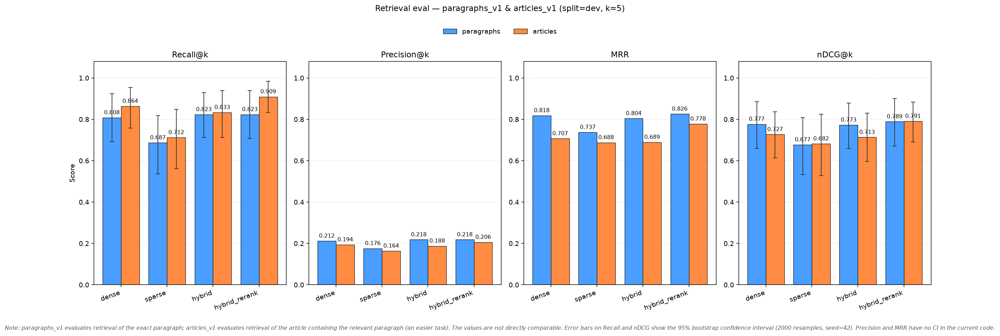
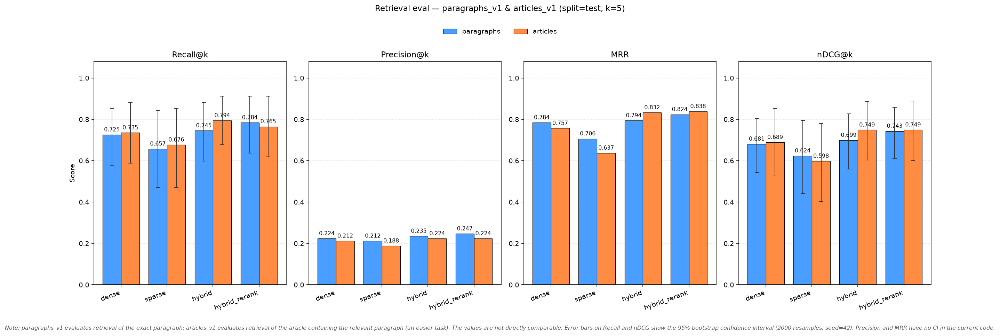
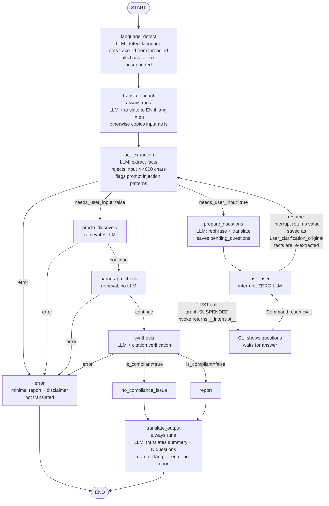
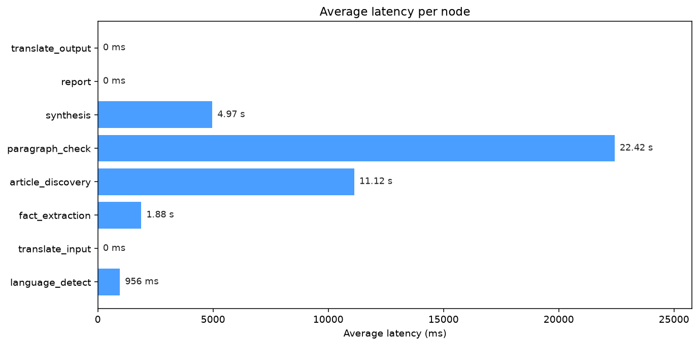

# AI Act Compliance Copilot

**Version:** 1, 2026-11-03

The project aims to show how a RAG system can be orchestrated over the AI Act, allowing the user to analyse their AI use case and obtain the legal issues of their system. The project is not intended as a substitute for the opinion of a legal professional, but as a support for the user's own awareness. The project develops the chunking of the source document, the generation of chunk embeddings, and their storage in a vector database. It then provides several retrieval methodologies whose performance is measured to select the best retrieval algorithm among those analysed. A graph is built with LangGraph to orchestrate the pipeline, and an LLM via API (DeepSeek, model `deepseek-chat`) evaluates and refines the results. Guardrails neutralise forbidden phrases, flag unverified citations, and detect prompt injection attempts. Latencies per node are highlighted and, after tuning on a dev set, the reliability of the system is evaluated on a test set. All flows are covered by a test suite that helps in debugging and in preventing unexpected behaviour. The project is not intended as a product ready for a production environment, but as an illustrative example of what can be built thanks to the development of AI solutions.

The project is structured in several phases:

- Setup and prerequisites
- Example input/output
- Chunking
- Retrieval
- Analysis of the metrics on Dev and Test Set
- Implementation of the Graph and Observability
- Running from the terminal
- Testing
- Latency per node
- Guardrails
- MCP 

---

# Setup and prerequisites

## Requirements

- Python 3.12+
- uv for dependency management
- Docker, to run Qdrant locally
- A DeepSeek API key
- About 2 GB of free disk space for the `BAAI/bge-m3` model (downloaded on first use), plus the `bge-reranker-v2-m3` cross-encoder

## Environment variables

Create a `.env` file in the project root:

```dotenv
DEEPSEEK_API_KEY=your_api_key_here
DEEPSEEK_BASE_URL=https://api.deepseek.com/v1
DEEPSEEK_MODEL=deepseek-chat
```

| Variable | Purpose |
|---|---|
| `DEEPSEEK_API_KEY` | API key used by every LLM call. Without it the client raises an error at start-up. |
| `DEEPSEEK_BASE_URL` | OpenAI-compatible endpoint of the provider. |
| `DEEPSEEK_MODEL` | Model used by the graph nodes (language detection, fact extraction, synthesis, translation). |

> Never commit `.env`. Make sure it is listed in `.gitignore`.

## Start Qdrant

Qdrant runs locally in Docker, configured through `docker-compose.yml` in the project root.

```bash
# 1. Start the container in the background
docker compose up -d

# 2. Check that it is running
docker ps
```

Once the container is up, verify that Qdrant responds and list the existing collections:

```bash
curl -s http://localhost:6333/collections | python -m json.tool
```

On a fresh instance the list is empty. After running `copilot.retrieval.index` it should contain `articles_v1` and `paragraphs_v1`.

The dashboard is available at <http://localhost:6333/dashboard>. To stop the container, run `docker compose down` (the data is kept if the compose file defines a volume).

## Execution order

The pipeline must be run in this order.

```bash
# 1. Parse the raw HTML of the AI Act into data/processed/ai_act.json
uv run python parse_html.py

# 2. Create the chunks (articles.jsonl and paragraphs.jsonl)
uv run python -m copilot.ingest.chunk_articles
uv run python -m copilot.ingest.chunk_paragraphs

# 3. Embed the chunks and write them to Qdrant (articles_v1, paragraphs_v1)
uv run python -m copilot.retrieval.index

# 4. (Optional) Evaluate the retrieval methods on the dev and test sets
uv run python -m evals.retrieval_eval

# 5. Run the copilot from the terminal
uv run python -m copilot.cli
```

---

# Example input/output

The example below is a real run in Italian (model-loading logs omitted, rationales of the open questions shortened). The system detects the language, asks for a missing required fact, then returns the report in the user's language. Citation claims are not translated, so they stay in English.

**Input**

```text
⚠ Do not enter real personal data: the text is translated and sent to DeepSeek.

Describe the case (one line, press Enter to confirm):
> devo fare scan dei cv dei candidati per decidere chi assumere
```

**Clarification round** (the required fact `operator_role` is missing)

```text
CLARIFICATION REQUIRED
  1. Qual è il tuo ruolo con questo sistema di IA? Scegli uno tra: fornitore,
     deployer, importatore, distributore, rappresentante autorizzato,
     fabbricante del prodotto, fornitore di GPAI, fornitore di GPAI con rischio
     sistemico.

Answer: deployer
```

**Output**

```text
RESULT
In qualità di deployer di un sistema di IA ad alto rischio per la selezione dei CV nell'ambito dell'assunzione, è necessario conformarsi agli obblighi del deployer di cui all'articolo 26, tra cui l'utilizzo del sistema secondo le istruzioni, la garanzia che i dati di input siano pertinenti e rappresentativi, il monitoraggio del funzionamento e l'informazione dei rappresentanti dei lavoratori e dei lavoratori interessati prima dell'uso sul luogo di lavoro. Il sistema è classificato come ad alto rischio ai sensi dell'allegato III, punto 4 (occupazione), ed è necessario garantire una supervisione umana efficace ai sensi dell'articolo 14, il che significa poter comprendere, interpretare, sovrascrivere e arrestare il sistema. È inoltre necessario basarsi sulle informazioni di trasparenza fornite dal fornitore ai sensi dell'articolo 13 e garantire la tenuta dei registri ai sensi dell'articolo 12. Una valutazione dell'impatto sui diritti fondamentali ai sensi dell'articolo 27 è richiesta solo se si è un organismo pubblico o un'entità privata che fornisce servizi pubblici, circostanza non indicata in questo caso. Successivamente, ottenere le istruzioni per l'uso e le informazioni di trasparenza dal fornitore, attuare misure di supervisione umana e stabilire pratiche di monitoraggio e tenuta dei registri.

Questa analisi è generata automaticamente a solo scopo informativo. Non
costituisce consulenza legale. Verificare con un professionista qualificato
prima di prendere decisioni.

Sources:
  ✓ [anx_III]   Recruitment and candidate selection is listed in Annex III point 4, making this a high-risk AI system.
  ✓ [art_26.p1] Deployers of high-risk AI systems must take appropriate technical and organisational measures to ensure use in accordance with instructions for use.
  ✓ [art_26.p4] Deployers must ensure input data is relevant and sufficiently representative.
  ✓ [art_26.p5] Deployers must monitor the operation of the high-risk AI system and inform providers and authorities of risks or serious incidents.
  ✓ [art_26.p7] Employers must inform workers' representatives and affected workers before putting into service a high-risk AI system at the workplace.
  ✓ [art_14.p1] High-risk AI systems must be designed for effective human oversight.
  ✓ [art_14.p4] Human oversight measures must enable understanding, interpretation, override, and interruption of the system.
  ✓ [art_13.p1] High-risk AI systems must be transparent to enable deployers to interpret output and use appropriately.
  ✓ [art_13.p3] Instructions for use must contain information on characteristics, capabilities, limitations, and human oversight measures.
  ✓ [art_27.p1] Fundamental rights impact assessment is required for deployers that are public bodies or private entities providing public services.

Open questions:
  [inferred] Ho ipotizzato che risk_tier = high_risk (...). Confermi?
  [inferred] Ho ipotizzato che sector = employment (...). Confermi?
  [inferred] Ho presupposto che uses_personal_data = true (...). Confermi?
  [inferred] Ho assunto che is_biometric = false (...). Confermi?
  [inferred] Ho assunto che is_gpai = false (...). Confermi?

Considered articles:
  - art_26: Obligations of deployers of high-risk AI systems
  - anx_III: ANNEX III - High-risk AI systems referred to in Article 6(2)
  - art_14: Human oversight
  - art_13: Transparency and provision of information to deployers
  - art_12: Record-keeping
  - art_3: Definitions
  - art_6: Classification rules for high-risk AI systems
  - art_27: Fundamental rights impact assessment for high-risk AI systems
```

Every citation is marked ✓ when its `chunk_id` was found among the retrieved paragraphs or candidate articles. The report ends with the disclaimer, and the open questions list every assumption the model made, so the user can confirm or correct them.

---

# Chunking

The pipeline starts from the file `data/raw/32024R1689_consolidated_2026-07-27.html.txt`, which contains the HTML text of the European law on AI (AI Act). The version of the file as well as its hash (to detect future changes) are contained in the file `data/raw/SOURCE.md`.

1. Through `parse_html.py`, a JSON was created that mirrors the content of the law article by article and paragraph by paragraph. The resulting JSON is `data/processed/ai_act.json`.
2. Starting from `data/processed/ai_act.json`, the scripts `copilot/ingest/chunk_articles.py` and `copilot/ingest/chunk_paragraphs.py` were developed, which create, respectively, the files `data/processed/articles.jsonl` and `data/processed/paragraphs.jsonl` that contain the chunks ready to be converted into embeddings and stored in a vector database.

---

# Retrieval

Below are the scripts involved in the embedding process, the write to the vector database (Qdrant in local Docker), and data retrieval with different methodologies:

1. `copilot/retrieval/embedders.py`: uses the **BAAI/bge-m3** model, which generates two representations:
    - Dense (1024 dimensions): captures semantic meaning.
    - Sparse ({token_id: weight}): captures lexical matching.

2. `copilot/retrieval/store.py`: a thin wrapper that handles everything that must interact with Qdrant and has 5 methods:
    - **ensure_collection**: creates the collection if it does not exist (idempotent), with a dense (cosine) and a sparse vector, plus keyword payload indices on `article`, `doc_type`, `annex`.
    - **upsert**: converts sparse dicts into `SparseVector(indices, values)`, builds the `PointStruct`s, and writes with `wait=True`.
    - **search_dense**: queries the dense vector only.
    - **search_sparse**: queries the sparse vector only.
    - **search_hybrid**: two `Prefetch` (dense and sparse, each with `limit × 4` candidates) fused with RRF (Reciprocal Rank Fusion), then truncated to `limit`.

    In `class QdrantStore` there is an injectable client. This is done for offline tests, which helped during debugging.

3. `copilot/retrieval/index.py`: the write pipeline (ingestion):
    - launched with `uv run python -m copilot.retrieval.index`.
    - creates two collections:
        - `articles_v1`: generates one point per article/annex. The embedded text is not the legal text, but a "semantic profile" summarised for each paragraph. It is used to answer "which article talks about X". The payload (`_article_payload`) also keeps roles, tiers, summaries, verbatim excerpt, and URL.
        - `paragraphs_v1`: generates one point per paragraph. Here the verbatim text (`r["text"]`) is embedded, useful for exact citations. The payload includes `chunk_id`, `article_title`, `tokens`, etc.

4. `copilot/retrieval/search.py`: the read pipeline from the vector database (retrieval); it offers 4 methods:
    - *dense*: query embedding for semantic similarity search.
    - *sparse*: sparse embedding for lexical search.
    - *hybrid*: dense + sparse fused with RRF on the Qdrant side.
    - *hybrid_rerank*: hybrid with k × 3 candidates, then client-side reranking with bge-reranker-v2-m3 (cross-encoder), keeping the top k.

---

# Retrieval evaluation on Dev set

These are the results for the dev set, which consists of 33 cases in `data/eval/cases.jsonl` marked as `"dev"`.



Precision@5 ≈ 0.2 means that, on average, about 1 of the 5 retrieved chunks is relevant. Since most evaluation cases have only one relevant chunk in the ground truth, the maximum achievable Precision@5 is 0.2, so a value close to it is not a sign of poor retrieval. Recall@k and MRR are more informative metrics for this dataset.

---

# Retrieval evaluation on Test set

These are the results for the test set, which consists of 17 cases in `data/eval/cases.jsonl` marked as `"test"`.



These results should be taken with a grain of salt: since the dataset (dev + test) is too small, the results may vary significantly as the number of cases in the set increases.

---

# Graph and Observability



## Graph nodes

| Box | What it does | LLM calls |
|---|---|---|
| **START** | Entry point. Receives the initial state `{"user_input": "..."}` and triggers `language_detect`. | None |
| **language_detect** | Calls `detect_language` on the raw `user_input`, which returns a language code (e.g. `it`, `en`, `ja`). If the code is not in `SUPPORTED_LANGUAGES`, it falls back to `en`. Reads `config["configurable"]["thread_id"]`, calls `set_trace_id` and stores it as `trace_id`, so every log line of the session can be correlated. | 1 (per `detect_language`) |
| **translate_input** | Always runs. If `detected_language != "en"`, translates `user_input` into English and stores it in `user_input_en`. If the language is `en`, it copies `user_input` into `user_input_en` without calling the LLM. Everything downstream works on English text. | 1 if lang != `en`, otherwise 0 |
| **fact_extraction** | Builds a prompt with `<user_input>` (English text) and, on later passes, `<user_clarification>` (the latest answer, translated into English if lang != `en`). The LLM extracts structured facts with `status ∈ {known, inferred, unknown, missing}` and `required ∈ {true, false}`. Facts are **re-extracted from scratch** from the input plus the latest clarification, not merged with the previous facts. Non-required `unknown` facts are discarded. `needs_user_input = True` iff at least one `required` fact is `unknown` or `missing`. Also flags prompt-injection patterns in `suspicious_input` (logged only, non-blocking). Input longer than `MAX_INPUT_CHARS` (4000) returns `{"error": "input_too_long: ..."}` before any LLM call. | 1, plus 1 to translate the clarification if one exists and lang != `en`. 0 if the input is too long |
| **prepare_questions** | Runs only when `needs_user_input = True`. Calls `nodes.ask_user`, which builds a prompt from the blocking facts (`field`, `rationale`, `allowed_values` from `_ALLOWED_VALUES`) and asks the LLM to rephrase them as natural questions in English. If that call fails (`LLMError`), it falls back to the template ``Please provide a value for `field`.`` Then, if lang != `en`, translates **each** question. The result is stored in `pending_questions`. | 1 reformulation (attempted even if it fails) + N translations if lang != `en`, where N = number of questions produced. Translations also apply to the fallback questions |
| **ask_user** | Reads `pending_questions` and calls `interrupt({"questions": [...]})`, which **suspends the graph** and returns control to the caller. The node does not display anything: the caller shows the questions. On resume, LangGraph re-runs the node from the top, `interrupt()` returns the value passed in `Command(resume=...)`, and the node stores it in `user_clarification_original`. The node never calls the LLM; all LLM work lives in `prepare_questions`, so re-running it is harmless. | 0 |
| **article_discovery** | Builds a query from the `known`/`inferred` facts (`_query_from_facts`, e.g. `operator_role=provider risk_tier=high_risk`, or the raw user input if there are none) and searches `articles_v1` with `hybrid_rerank`, `limit=15`. Passes the candidates to the LLM, which selects the relevant ones with a one-sentence rationale. IDs not in the retrieved list are dropped. | 1 |
| **paragraph_check** | Single retrieval pass on `paragraphs_v1` (`hybrid_rerank`, `limit=50`), grouped in memory by article number. For each candidate article (`art_` prefix stripped) it takes up to 5 paragraphs; if the article has no direct hits, it falls back to the first 3 global hits. Deduplicates by `chunk_id`. With no candidate articles it returns `[]` without retrieving. Candidate IDs that are not articles (e.g. annex IDs) never match by number, so they always use the fallback. | 0 (1 retrieval) |
| **synthesis** | Sends facts, candidate articles and paragraphs to the LLM and asks for `summary`, `citations` (`{claim, chunk_id}`) and `has_compliance_issue`. A citation is `verified=True` only if its `chunk_id` is among the retrieved paragraph chunk IDs **or** the candidate article IDs. Sets `is_compliant = not has_compliance_issue`. | 1 |
| **no_compliance_issue** | Minimal report branch (`is_compliant = True`). Builds a `Report` with `open_questions=[]` and the list of unverified citations, then applies `_apply_report_guards`: forbidden-phrase neutralization, unverified-citation warning, disclaimer. | 0 |
| **report** | Full report branch (`is_compliant = False`). Emits one `OpenQuestion` for each `inferred`, `unknown` or `missing` fact, then applies the same guards. The question templates are in Italian. The `unknown` template is effectively unreachable: non-required unknowns are dropped in `fact_extraction` and required ones block the flow before this point. | 0 |
| **translate_output** | Always runs. If lang is `en` or there is no report, it returns `{}` (so `final_answer` is **not** set). Otherwise it translates `summary` (which already contains the disclaimer and the unverified-citation warning added by `_apply_report_guards`) and each `open_questions[].question`, then sets `report` and `final_answer = translated_summary`. Facts, citation claims and article titles are not translated. | 1 + N if lang != `en` (N = open questions), otherwise 0 |
| **error** | Minimal report branch, used when any routed node sets `state["error"]`. The summary is an Italian template ending with the error text (it always says "errore nel LLM", even for `input_too_long`). `citations` and `open_questions` are empty. Guards are applied. This branch goes straight to `END` and is **never translated**. | 0 |
| **END** | Terminal node. The caller receives the final state, including `report`. | None |

## Edges

| Edge | When | What it means |
|---|---|---|
| `START → language_detect` | Always | Language detection comes first, because later nodes need `detected_language`. |
| `language_detect → translate_input` | Always | Input is translated into English, or copied unchanged if it is already English. |
| `translate_input → fact_extraction` | Always | Fact extraction, retrieval and synthesis work on English text. |
| `fact_extraction → error` | `state["error"]` is set (`route_after_facts`) | An `LLMError` inside the extraction call, or `input_too_long`. |
| `fact_extraction → article_discovery` | `needs_user_input = false` (`route_after_facts`) | No blocking fact is missing, so the flow proceeds to retrieval. |
| `fact_extraction → prepare_questions` | `needs_user_input = true` (`route_after_facts`) | At least one required fact is `unknown` or `missing`. The router value is `"ask_user"`, mapped to the node `prepare_questions`. |
| `prepare_questions → ask_user` | Always | Questions are in `pending_questions` (already translated if lang != `en`). `ask_user` calls `interrupt()` and the caller displays them. |
| `ask_user → fact_extraction` | Always, reached only after a resume | `Command(resume=answer)` re-runs `ask_user`, `interrupt()` returns the answer, and the flow goes back to `fact_extraction`, which re-extracts facts from `user_input_en` plus the latest clarification. If blocking facts remain, another `prepare_questions → ask_user` round starts. The CLI stops after `max_clarifications` (default 5, `cli.py`). The MCP server has no cap. |
| `article_discovery → error` | `state["error"]` is set (`route_after_any`) | The LLM call failed. Retrieval exceptions (e.g. Qdrant unreachable) are not caught and propagate out of `invoke`. |
| `article_discovery → paragraph_check` | No error (`route_after_any`) | Retrieves the verbatim paragraphs for the selected articles. |
| `paragraph_check → error` | `state["error"]` is set (`route_after_any`) | Defensive only: a failure in `article_discovery` already routes to `error`, so `paragraph_check` cannot currently see an error. |
| `paragraph_check → synthesis` | No error (`route_after_any`) | Synthesis needs facts, candidate articles and paragraphs. |
| `synthesis → error` | `state["error"]` is set (`route_after_synthesis`) | The synthesis call failed with `LLMError`. |
| `synthesis → no_compliance_issue` | `is_compliant = true` (`route_after_synthesis`) | The LLM found no compliance issue. Minimal report. |
| `synthesis → report` | `is_compliant = false` (`route_after_synthesis`) | The LLM found obligations or issues. Full report with open questions. |
| `no_compliance_issue → translate_output` | Always | Both report branches converge on translation. |
| `report → translate_output` | Always | Same as above. |
| `translate_output → END` | Always | Report is in the user's language (or unchanged if the input was English). |
| `error → END` | Always | The error branch still builds a `Report`, but it is not translated. |

---

# Running from the terminal

Run the command `uv run python -m copilot.cli`: the user will then be asked to enter their use case, after which the graph execution will begin.

---

# Latency per node

The latency per node is measured on a Macbook Pro M2 and the results are the following:



The first run is slower because the embedding and reranking models are loaded in memory.

---

# Guardrails

| Guardrail | Where | Behaviour |
|---|---|---|
| LLM budget limit | `llm.py` | Each `LLMClient` instance accumulates the estimated cost of its calls. Once it reaches 0.50 USD (`max_cost_usd`), further calls raise `budget_exceeded` and the graph routes to `error`. The check runs before each call, so the last call can slightly exceed the limit. |
| Input length limit | `fact_extraction` | Inputs longer than `MAX_INPUT_CHARS` (4000) are rejected before any LLM call. |
| Prompt injection detection | `fact_extraction` | Suspicious patterns set `suspicious_input`. The event is logged, but the flow continues (detect-and-proceed, not reject). The user text is wrapped in `<user_input>` tags and tests check that it cannot alter the extracted `risk_tier`. |
| Citation verification | `synthesis` | A citation is `verified=True` only if its `chunk_id` is among the retrieved paragraphs or the candidate articles. |
| Unverified-citation warning | `_apply_report_guards` | A warning is added to the report when at least one citation is not verified. |
| Forbidden-phrase neutralisation | `_apply_report_guards` | Phrases matching `FORBIDDEN_PATTERNS` (e.g. definitive legal verdicts) are neutralised. |
| Disclaimer | `_apply_report_guards` | Always appended, on every branch, including `error`. |
| Clarification cap | `cli.py` | The CLI stops after `max_clarifications` rounds (default 5). The MCP server has no cap. |

---

# Testing

No test needs a real LLM, Qdrant, or the 2 GB `bge-m3` model: every external dependency is replaced with a fake at the boundary, so the suite is deterministic, fast, and CI-friendly.

## Test files

| File | Covers | Strategy |
|---|---|---|
| `test_graph_flow.py` | End-to-end graph: happy paths, clarification loop, multilingual input, error routing | `FakeLLM` + `FakeRetriever` |
| `test_nodes.py` | Each node in isolation (`fact_extraction`, `article_discovery`, `paragraph_check`, `synthesis`, `report_node`, `error_node`) | `FakeLLM`, `patch_retriever` |
| `test_adversarial.py` | Prompt injection must not alter the extracted `risk_tier` | `FakeLLM`, one case per line of `adversarial.jsonl` |
| `test_output_guards.py` | Forbidden phrases neutralised, disclaimer always appended, unverified-citation warning | Pure function on `_apply_report_guards` |
| `test_language.py` | Detection, translation IT↔EN, fallback on `LLMError`, unsupported-language no-op | `FakeLLM` |
| `test_llm_client.py` | JSON parsing, Pydantic validation, empty content, missing choices, token counters, missing API key | Mock `OpenAI` client |
| `test_budget.py` | Budget blocks first/second call, allows under limit, accumulates cost | Mock `OpenAI` with controlled `usage` |
| `test_index.py` | Payload builders keep `chunk_id` and `text`; article profile includes title/summary/conditions | Pure functions, no Qdrant |
| `test_search.py` | Each method returns `{id, score, payload}`, `hybrid_rerank` calls rerank, unknown method raises | Mock `QdrantStore` + `Embedders` |
| `test_embedders.py` | Injected `dense_fn`/`sparse_fn`, `dense_dim == 1024` | No model download |
| `test_chunk_articles.py` | One record per article/annex, schema, hallucinated roles/tiers dropped, `limit` | Mock `LLMClient` |
| `test_chunk_paragraphs.py` | Placeholders skipped, long paragraphs stay atomic (no `.sN`), JSONL shape | `_count_tokens` patched |

## Design choices

- **Fakes at the boundaries, real logic inside.** Graph, nodes, guardrails, normalisation, and payload builders are under test. LLM, Qdrant, and models are faked. Tests stay fast and deterministic.
- **The fake LLM mirrors the real interface.** `FakeLLM` validates responses against the actual Pydantic schema and records every call, so tests assert *what was sent* (prompt, schema, system prompt), not just *what came back*.
- **The clarification loop is end-to-end.** `test_clarification_loop_italian` exercises `interrupt()` / `Command(resume=...)`: interrupt with Italian questions, resume, re-extraction, translated open questions. LangGraph re-runs nodes on resume, the most fragile part of the flow.
- **Adversarial inputs are first-class.** `test_adversarial.py` reads `adversarial.jsonl` and asserts `suspicious_input == True` and `risk_tier` unchanged. The design is detect-and-proceed, not reject.
- **Guardrails are tested as pure functions.** `_apply_report_guards` is called directly on synthetic reports, parametrised over `FORBIDDEN_PATTERNS`.
- **Budget is tested at the boundary.** A mock `OpenAI` returns a controlled `usage`, so the test checks guard semantics, not real token prices.
- **Chunkers avoid the tokenizer download.** `_count_tokens` is patched with word count; the test verifies the *logic* of `_is_placeholder`, "no splitting", and JSONL shape, not the token count.

## What is **not** tested

- **LLM quality.** The fake returns pre-baked responses; quality is only checked through manual review of reports.
- **Retrieval quality.** `test_search.py` checks shape and dispatch, not recall@k or MRR.
- **Qdrant behaviour.** No real Qdrant. Index creation, upsert, and hybrid fusion are not tested against a live server.
- **Concurrency.** The graph is single-threaded; `MemorySaver` under parallel invocations is not covered.
- **Model loading.** `Embedders` is tested only with injected functions. The singleton cache is not covered (too slow, too heavy for the suite).

## Run a single test

```bash
uv run pytest tests/test_graph_flow.py -v
uv run pytest tests/test_graph_flow.py::test_clarification_loop_italian -v
uv run pytest -k "budget" -v
```

## Reproducibility

- `FakeLLM` responses are explicit lists passed by each test → order and content are deterministic.
- Bootstrap CI in `retrieval_eval.py` uses `seed=42` → identical CIs on rerun.
- `test_missing_api_key_raises_in_clean_process` runs in a subprocess with empty env and empty cwd → cannot be fooled by a `.env` file.

---

# MCP

The copilot is also exposed as a [Model Context Protocol](https://modelcontextprotocol.io) server (streamable HTTP), so any MCP client can query the AI Act corpus and run the compliance graph as tools. It has been tested with Claude Code desktop, with the server running locally and published through a Cloudflare tunnel.

```bash
# Qdrant must be running and the collections indexed (see Setup)
uv run python -m copilot.mcp_server --host 127.0.0.1 --port 8000

# In another terminal: publish it with a Cloudflare quick tunnel
cloudflared tunnel --url http://localhost:8000
```

`cloudflared` prints a public `https://<random-name>.trycloudflare.com` URL (it changes at every run). Use it, followed by `/mcp`, as the address of the remote MCP server in the client. For purely local use the tunnel is not needed: connect to `http://localhost:8000/mcp`.

| Tool | Purpose |
|---|---|
| `search_regulation` | Search the corpus (`dense`, `sparse`, `hybrid`, `hybrid_rerank`), on verbatim paragraphs or article/annex profiles. |
| `get_article` | Exact text of an article, optionally of a single paragraph. |
| `get_annex_point` | Text of an annex or of one of its points. |
| `get_applicability_date` | Application date of an article for a given risk tier. |
| `assess_ai_system` | Runs the full graph on a system description. |

`assess_ai_system` is stateful. If the graph needs a missing fact it returns `{"status": "clarification_needed", "questions": [...], "thread_id": "..."}`; the client shows the questions and calls the tool again with the same `thread_id` and the user's reply as `answer`, until it returns `{"status": "completed", "report": {...}}`. Unlike the CLI, there is no limit on clarification rounds.

**Configuration** (environment variables): `QDRANT_URL` (default `http://localhost:6333`), `MCP_RATE_LIMIT` (requests per window, default 30, `0` disables it), `MCP_RATE_WINDOW` (seconds, default 60), `LOG_LEVEL`.

> **Security note.** The server has no authentication. Behind a tunnel it is reachable by anyone who knows the URL, so it is meant for demos and tests, not for production. Protections are an in-memory per-IP rate limit (the client IP is read from the `CF-Connecting-IP` header set by Cloudflare) and the LLM budget cap (0.50 USD per `LLMClient` instance). The MCP server uses a single instance, so once the cap is reached every `assess_ai_system` call fails until the server is restarted. Stop the tunnel when it is not needed.

---

> **Disclaimer.** This project is an illustrative example and does not constitute legal advice. For any real compliance assessment, consult a qualified legal professional.